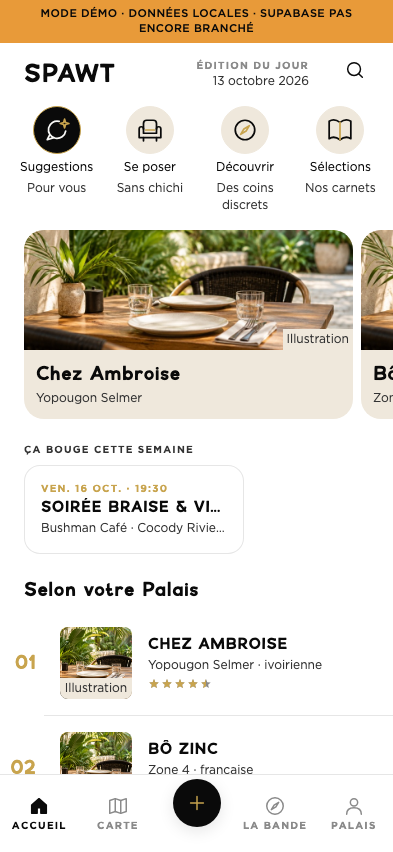
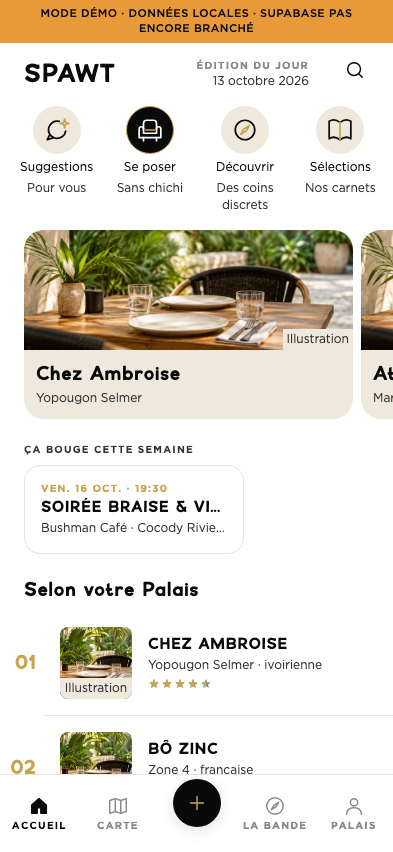
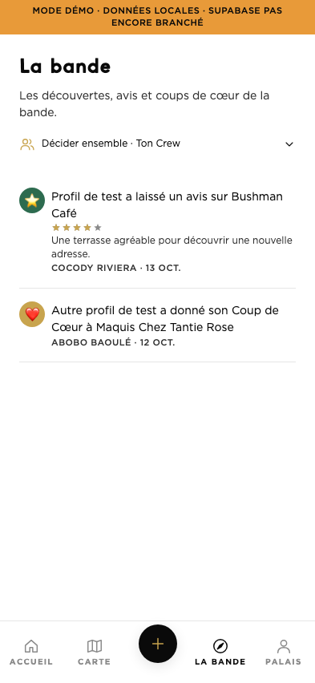

> Complément demandé le 13 octobre : La Bande est maintenant raccordée aux activités publiques réelles et l’APK build 29 est autorisée. Le bilan initial ci-dessous reste la trace de la première revue ; voir [la livraison build 29](ANDROID_1_1_1_BUILD29_BANDE.md) pour l’état final et les nouvelles preuves.

# Accueil et La Bande — revue du 13 octobre 2026

## Reprise et périmètre

PR existante [#13](https://github.com/xtincell/spawt-ci-mobile-v1-mvp/pull/13), ouverte en brouillon.
Branche conservée : `codex/audit-avant-compilation`. Synchronisation en avance rapide
`9ae0208 → 7063dbc` avant toute édition. Les assets et preuves préexistants de
`outputs/` et les fichiers locaux ignorés sont conservés. Aucun chantier parallèle.

Sources inspectées : `CLAUDE.md`, skills projet `spawt-context` / `spawt-dev`,
`documentation/SPRINT_1_CAHIER_DES_CHARGES.md`, PRD FR-004/FR-009,
`mvp-finalisation-plan.md`, implémentations Accueil/Explore/Meute/Crew et adaptateurs.
Les inventaires anciens des skills ne sont pas un état actuel du code : les
carnets, les votes et leurs feature flags sont déjà implémentés.

## Comportements livrés

- Une rangée discrète de disques de 48 px, selon la référence fournie à 12:03 :
  **Suggestions**, **Se poser**, **Découvrir**, **Sélections**, avec leurs quatre
  sous-titres demandés. Le nom accessible complet reste « Suggestions du jour ».
  Le disque actif est noir, son dessin blanc et or ; les autres sont crème,
  dessin noir et or. Le style suit les quatre choix. Les libellés restent noirs
  et les sous-titres gris sur la surface blanche, conformément à la référence.
- Quatre dessins vectoriels dédiés via `react-native-svg`, déjà installé : bulle
  et étincelle, fauteuil, boussole, carnet ouvert. Aucun bitmap dans les icônes.
- Suggestions est sélectionné au départ. Réappuyer sur le choix courant ne le
  désélectionne pas. Les textes agrandis peuvent faire défiler horizontalement
  la rangée ; aucun libellé réduit automatiquement ni ellipse sur le sélecteur.
- Le grand bandeau Moka des suggestions est retiré. Le carrousel utilise des
  tuiles photo compactes, titres complets en flux, quartier ou description.
- Le **feed entier** reste classé par le moteur Palais existant et son traitement
  des horaires. Aucun mode ne participe à son calcul. La liste conserve aussi
  ses trois premiers lieux lorsque le carrousel présente autre chose.
- Les promotions restent des étiquettes, pas une pondération du matching ;
  les impressions visibles et les clics des cartes conservent leurs événements.
- Photos officielles prioritaires. Absence ou échec : image d’attente embarquée,
  explicitement marquée **Illustration**, accessible « Photo à venir ». Elle
  est également utilisée par les petites tuiles de la liste. Changement d’URL :
  nouvelle tentative. L’illustration générée (~125 Ko) ne représente aucun lieu.
  La fixture Bushman Café utilise sa vraie couverture officielle déjà publiée.

| Choix | Source et règle réelle |
|---|---|
| Suggestions du jour — Pour vous | Les trois premiers du classement existant. Aucune rotation quotidienne ni visite inventée. |
| Se poser — Sans chichi | Maximum trois lieux, prix niveau 1/2 et ADN décontracté négatif. Heuristique existante, limitée au carrousel. |
| Découvrir — Des coins discrets | Maximum trois lieux avec axe populaire/privé positif. Le badge « découverte » seul ne prouve pas qu’un lieu est discret. |
| Sélections — Nos carnets | Collections éditoriales publiées, ordre `sort_order`, sous le flag existant `mode-explore`. Choix sur place ; seule la carte ouvre `/explore/[slug]`. |

Carnets fermés par flag : explication sur place, aucun fetch et aucune navigation
inutile. Flag ouvert : chargement, résultat vide, erreur avec réessai distincts.
Un rafraîchissement raté conserve les carnets déjà lisibles. Les réponses d’un
ancien choix sont ignorées. Aucun flag distant n’a été activé pour cette revue.
L’adaptateur offre une lecture stricte à ce nouveau parcours tout en conservant
le contrat historique des anciens callers Explore.

## La Bande et limite produit

Le titre et le fil communautaire (avis publics hors fondateurs et coups de cœur)
restent prioritaires. Le Crew est un accès secondaire replié, sous `mode-crew`.
L’invitation avec code ouvre son formulaire sans rejoindre automatiquement.
En duo/en groupe sont des **contextes explicatifs du vote existant**, sans faux
boutons ni prétendu filtrage par taille de groupe. Le formulaire rejoint/crée
les mêmes sessions temporaires ; champ et bouton sont empilés pour éviter le
problème de débordement observé à la recette.

Le CdC Sprint 1 reporte le Crew, tandis que le code post-MVP le possède déjà sous
flag. Le PRD FR-009 utilise « Tanière » pour les favoris personnels ; il ne définit
pas le cercle privé durable décrit par Alexandre. Ce cercle n’a pas de modèle
implémenté ici et n’a pas été remplacé par le Crew. **À arbitrer séparément** :
une Tanière durable et d’éventuelles règles propres au duo/groupe demandent un
périmètre produit distinct. Aucun changement de schéma ou de droits dans ce lot.

Une erreur de lecture communautaire n’est plus transformée en activité vide :
message de réessai, liste précédente conservée, chargement distinct. La séquence
de requêtes empêche qu’une ancienne réponse remplace le résultat courant.

## Vérifications et limites

- TypeScript, vocabulaire et i18n : exécutés sans erreur.
- Suite mobile complète : **1 032 tests réussis, 4 ignorés**, 150 suites réussies / 1 ignorée, 4 snapshots conformes (44 s).
- Tests ciblés : quatre choix/états/labels, appuis répétés, ordre et scores du feed
  strictement inchangés, navigation fiche, carnets ouverts/fermés/chargement/vide/
  erreur/réessai, images absentes/défaillantes/nouvelle URL, états de La Bande,
  flag Crew et invitations. Les mocks réseau restent explicitement des tests.
- Navigateur Chromium sur **le code Expo mobile rendu en web**, pas le prototype
  Vite gelé. 320/360/393/430 px × texte 100/130/150 %, 20 captures, aucun
  `pageerror`. Cibles du sélecteur ≥44 px ; première tuile éditoriale visible.
  Changements répétés, retour aux Suggestions, fiche/carnet aller-retour,
  maintien du feed et vraie couverture Bushman chargée contrôlés dans le DOM.
- L’agrandissement CSS est une approximation web, **pas une preuve du réglage de
  texte Android/iOS**. Les captures à 150 % montrent un sélecteur défilable et
  des libellés complets. Les onglets historiques du bas se tronquent dans cette
  simulation CSS ; leur `adjustsFontSizeToFit` natif n’y est pas exercé.
- La Bande sur les captures contient deux **activités de test locales**, jamais
  insérées en base. Le vrai état vide démo a également été inspecté. Les carnets
  sont les fixtures existantes ; leur flag est forcé dans le navigateur isolé.
- Ni nouvelle APK/IPA, ni émulateur, ni TalkBack/VoiceOver pour ce lot. Pas de
  nouvelle authentification serveur ni de recette de vote entre deux comptes.
  Les tests existants du Crew passent dans la suite source.
- Admin et SQL inchangés : pas de nouvelle exécution de leurs suites. Aucune
  migration, aucun déploiement, aucune OTA, aucun changement de version/build,
  aucune fusion de PR.

## État de remise

Changements préparés localement dans l’index Git de la branche existante ; pas
de commit ni de push pendant cette revue. La PR 13 reste ouverte en brouillon
et sa tête distante demeure `7063dbc`. Diff disponible dans le panneau de revue
local et dans `outputs/accueil-bande-2026-10-13/code.diff`.

## Captures pour revue

Données de démonstration signalées dans le bandeau de l’application.

| Suggestions actives | Se poser actif | La Bande |
|---|---|---|
|  |  |  |

Autres captures : [Sélections](qa/accueil-bande-2026-10-13/accueil-selections-393.png),
[Crew déplié](qa/accueil-bande-2026-10-13/la-bande-crew-secondaire-393.png),
[320 px / 150 %](qa/accueil-bande-2026-10-13/accueil-320-150.png),
[vraie couverture](qa/accueil-bande-2026-10-13/photo-source-bushman.png).

Les quatre fichiers `icone-*.svg` sont des exports vectoriels de l’implémentation.
`HomeModeIcon.tsx` reste leur source de vérité. Les couleurs viennent des tokens.

## Rejouer la recette web

Depuis `app/` :

```sh
EXPO_NO_DOTENV=1 EXPO_PUBLIC_DEMO_MODE=true npx expo start --web --offline --port 8084
```

Depuis la racine (Playwright et son Chromium disponibles) :

```sh
node scripts/qa-home-selector.cjs
```

Variables facultatives : `PLAYWRIGHT_MODULE`, `CHROMIUM_PATH`, `QA_URL`,
`QA_OUTPUT`. Le script utilise uniquement les modules Metro de développement
pour des fixtures et des flags locaux ; il ne modifie aucun serveur.
Le fichier `browser-proof.json` décrit la matrice et la portée de la preuve.
