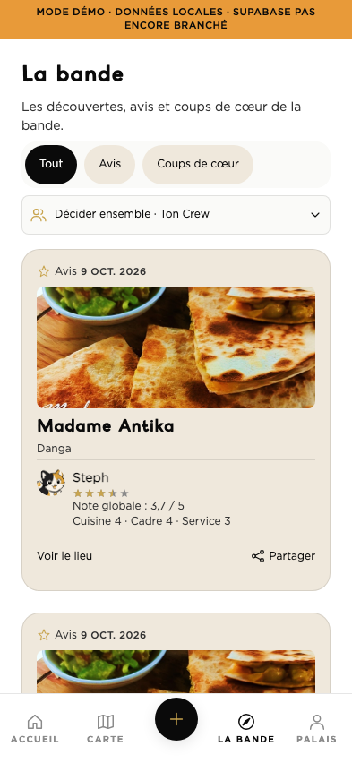
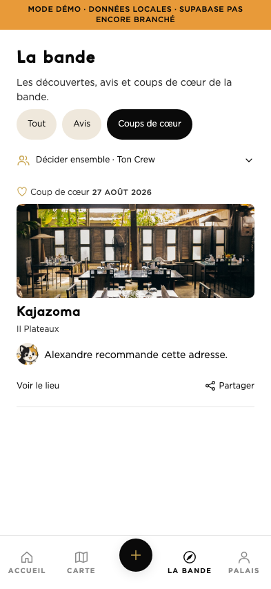
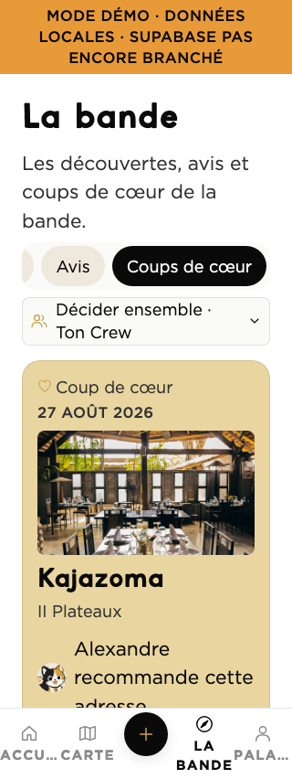

# Android 1.1.1 — build 29 : Accueil et La Bande

## Périmètre livré

Demande du 13 octobre : terminer cette version et compiler l’APK avec Expo.
Même branche locale `codex/audit-avant-compilation`, PR 13 toujours ouverte/brouillon.
Les sources de cette livraison sont accessibles sur le tag `local-build-android-2026-10-13-29`.
La branche distante de la PR reste à `7063dbc` : lecture Coolify du 13 octobre confirmant
`spawt-admin` avec auto-déploiement activé sur cette branche et aucun filtre de chemins.
La livraison utilise donc uniquement les tags ; aucun réglage Coolify n’a été modifié.
[Diff applicatif publié](https://github.com/xtincell/spawt-ci-mobile-v1-mvp/compare/7063dbc...bd0b61f).
La demande finale conserve tous les filtres sur une seule ligne horizontale défilante.
Les fonds distinguent les fonctions : sélecteur clair, éditorial sur crème avec cartes blanches,
avis sur crème et coups de cœur sur or clair. Les libellés et icônes doublent ce repère coloré.
Les changements d’Accueil déjà présents sont conservés : quatre choix discrets,
SVG dédiés, carrousel indépendant du classement Palais, photos et illustration de secours.

La Bande reprend le fil communautaire du plan de finalisation (§ phase 2, chantier 15)
et les cartes illustrées du kit `midfi-screens-6.jsx`. Elle affiche les avis publiés
(hors avis fondateurs), les coups de cœur, les auteurs publics avec Moka par défaut,
les notes cuisine/cadre/service et leur moyenne, les photos d’avis signées et les
photos officielles des lieux. Un ancien avis reste à note unique.
Les longs avis se déplient. La fiche du lieu, le partage natif et le signalement
réutilisent les parcours existants. Aucun compteur de réaction ni statut de présence fictif.

- Trois filtres réels : Tout, Avis, Coups de cœur. Ils portent uniquement sur La Bande.
- Pagination de 20 activités par curseur date + UUID, tri commun aux deux sources.
  Plus de quota arbitraire de 15 avis / 15 coups de cœur qui amputait le fil.
- Relecture au retour sur l’onglet et à la publication ; rafraîchissement manuel.
- Échec initial, liste vide et panne d’actualisation distincts ; contenu précédent conservé,
  réessai de pagination et verrou synchrone contre les doubles appuis.
- Les réponses d’un ancien filtre ou d’un écran quitté sont ignorées.
- Boutons d’au moins 44 dp, filtres défilants sur une seule ligne avec recentrage de la sélection,
  noms de lieux complets. Le fil reste prioritaire ; Crew replié et sous son flag existant.

## Accès aux données

L’ancienne expression `spawters_public:spawters!inner` renommait la table privée :
elle n’interrogeait pas la vue publique. Le nouveau lecteur récupère uniquement
`id, display_name, avatar_url` depuis `spawters_public`, en une requête groupée.
Les lieux sont explicitement filtrés `is_published=true`, y compris pour un compte staff.
Aucune migration ni écriture serveur n’est nécessaire.

Lecture réelle anonyme avec le code de l’adaptateur : **2 avis + 1 coup de cœur**.
L’ancienne requête du coup de cœur renvoie **0**. Curseur testé sur deux pages sans doublon.
`node scripts/qa-community-live.cjs` reproduit ce contrôle en lecture seule.

## Vérifications

- TypeScript, vocabulaire et i18n : passent.
- Suite mobile : 1 038 tests passent, 4 ignorés ; 4 snapshots passent.
- Conformité : 264 assertions passent ; seul avertissement attendu, identifiants stores absents.
- Expo web : 23 captures, matrice Accueil 320/360/393/430 px × texte CSS 100/130/150 %,
  filtres répétés de La Bande, retour Accueil et indépendance du feed, aucune erreur navigateur.
- La Bande 320 px / texte CSS 150 % : filtres défilants sur une seule ligne (décision finale d’Alexandre), photos visibles,
  contenu défilable. Le grossissement CSS ne remplace pas le réglage natif Android ;
  les libellés historiques de la barre inférieure restent tronqués dans cette approximation.
- Les captures « activité publique » rejouent dans l’app Expo web les trois lignes
  obtenues par la lecture réelle. Le bandeau indique honnêtement le runtime de démonstration.
  Cela vérifie le rendu, pas une session native connectée. Les fixtures supplémentaires
  servent uniquement aux états réseau / pagination, jamais insérées en base.

| Activité publique | Coups de cœur | Petit écran, texte agrandi |
| --- | --- | --- |
|  |  |  |

**[Télécharger l’APK alpha build 29](https://github.com/xtincell/spawt-ci-mobile-v1-mvp/releases/download/local-build-android-2026-10-13-29/spawt-1.1.1-build29.apk)**.
Publication vérifiée : préversion GitHub, taille et empreinte distantes identiques au fichier local ; téléchargement anonyme HTTP 200.

Source du binaire : `bd0b61f1a2701abd28d205cb9d0375295b64ca9d`.
Le premier lancement a été annulé avant compilation pour inclure les fonds différenciés.
Le [lancement cloud final](https://github.com/xtincell/spawt-ci-mobile-v1-mvp/actions/runs/38394175106)
a passé toutes les gates puis a été refusé par Expo : quota Android gratuit épuisé jusqu’au 1er novembre 2026.
Repli EAS local avec signature existante : [compilation 38394529426](https://github.com/xtincell/spawt-ci-mobile-v1-mvp/actions/runs/38394529426), **réussie**. APK 1.1.1 / build 29 : 162 425 603 octets ; signature vérifiée, identique au build 25, CRC valide.
SHA-256 : `4dbdc7cb94ecabf2691399dabe06d66093c503ea186988ebd5f36a363b62738a`.
Après téléchargement local : taille, empreinte et CRC vérifiés ; certificat extrait identique au build 27. La validation cryptographique complète reste celle du runner (`apksigner verify`).
L’export Android/Hermes local (2 623 modules, 92 assets) réussit aussi.
La [recette native 38399174943](https://github.com/xtincell/spawt-ci-mobile-v1-mvp/actions/runs/38399174943) **réussie**, utilise le compte alpha existant 0101, sans publication d’avis ni création de compte.

### Recette du binaire Android 29

Android 35 sur émulateur : **67 assertions passent**. La Bande contrôlée à
320/360/393/430 dp et avec le réglage natif de texte à 100/130/150 %.
Les 12 hiérarchies UI confirment les filtres sur une seule ligne ; les captures
ont été inspectées. Les cartes grandissent avec le texte et restent défilables.
Les 60 changements de filtre conservent des cibles tactiles d’au moins 44 dp.
Navigation fiche/retour, ouverture du partage natif sans envoi et restauration
après arrêt du processus passent. L’Accueil est capturé en Suggestions et Se poser :
le carrousel change tandis que les premiers lieux du classement restent identiques.
Le contrôle de l’animation fournie passe également dans cette APK.

[Preuves natives](qa/bande-build29/native/) : captures et assertions conservées.
Les erreurs réseau et la pagination sont couvertes par les tests source ; cette
recette native ne publie pas de contenu. TalkBack et appareil physique non testés.
Aucune fusion, publication store, OTA ni modification du backend de production.

## Préparation V2 — explicitement différée par Alexandre

La **Tanière durable** et les **abonnements entre membres** ne sont pas introduits
par cette APK. Le Crew actuel reste une session temporaire avec invitation/propositions/votes.
Avant V2 : décider visibilité/consentement des profils et du fil suivi, invitation et
sortie d’un cercle durable, partage des adresses, blocage/signalement et suppression des
relations. Ensuite schéma/RLS/RPC réversibles, parcours fonctionnels et recette à deux comptes.
Les réactions, commentaires de second niveau et statuts de présence dessinés dans le
kit n’ont pas de contrat de données validé ; aucun bouton inactif n’est ajouté.
