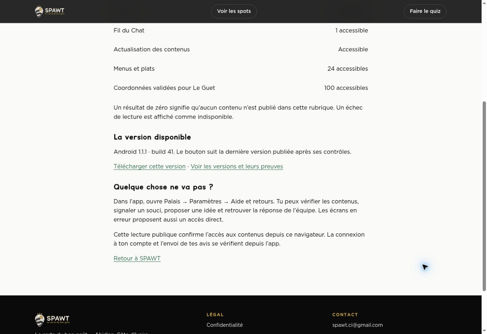

# Continuité des téléchargements Android — 31 octobre 2026

**Le téléchargement officiel du build 41 est reçu après correction des anciens liens en 404. Le build 42 reste en attente de publication.** Le contrôle réseau s’est terminé le **31 octobre 2026 à 18:48:18 UTC**.

## Correctif déployé

La vitrine utilise le [commit `14e6a34`](https://github.com/xtincell/project_spawt_mobile_ci/commit/14e6a34c722f47aa6a318bc8253af390c74017b0). Le [lien stable](https://spawt.online/downloads/spawt-latest.apk) redirige en HTTP 307 vers le build 41 disponible. Les anciens liens connus redirigent vers leur fichier d’origine dans les releases publiques.

**Onze routes historiques sont reçues : six APK et cinq fichiers SHA256**, pour les builds 27, 29, 34, 35, 36 et 40. Chaque cible exacte a été contrôlée, avec une réponse finale HTTP 200. Une version inconnue conserve une réponse 404.

## Réception du fichier officiel

| Contrôle | Résultat |
|---|---|
| Fichier | `spawt-1.1.1-build41.apk` |
| Taille reçue | 162 536 491 octets |
| SHA256 du fichier complet | `62074f4dc68ec3c84dfce3f1e191b4353a3a1b8e6e979a7232600040dd0a6aa9` |
| Interruption volontaire | Après 8 Mio, soit 8 388 608 octets |
| Reprise | HTTP 206, `bytes 8388608-162536490/162536491` ; fichier complet et empreinte conformes |
| Fichier SHA256 public | HTTP 200, même empreinte et même nom de fichier |
| HTTPS | Certificat et nom d’hôte vérifiés sur `spawt.online`, `www.spawt.online` et `portail.spawt.online` ; HTTP redirige vers HTTPS |
| En-têtes du fichier | Type APK Android, pièce jointe, `Accept-Ranges: bytes`, `nosniff`, cache immuable |

Le build 35 a aussi répondu en HTTP 206 sur un échantillon de 1 024 octets, avec signature ZIP correcte. Son empreinte complète et celles des autres APK historiques n’ont pas été recalculées lors de ce contrôle.

La [CI de la vitrine](https://github.com/xtincell/project_spawt_mobile_ci/actions/runs/41230863949) est réussie : **10 fichiers de tests, 65 tests**, configuration nginx et tests de livraison reçus.

## Statut du build 42

Le [canal officiel](https://raw.githubusercontent.com/xtincell/spawt-ci-mobile-v1-mvp/android-releases/latest.json) reste au **build 41**. La [publication 42](https://github.com/xtincell/spawt-ci-mobile-v1-mvp/actions/runs/41219261126) est bloquée par la permission GitHub requise pour créer son tag de provenance ; aucune release 42 n’a été publiée. Le tag attendu est `local-build-android-2026-10-30-42`, sur `360d181c9c15c6378b06ec41893afeb6a653f120`.

Le candidat reçu conserve `fullLiveReceipt=false`, `consoleModerationReceipt=false` et `physicalGuetReceipt=false`. Le correctif de distribution ne transforme pas ces preuves ouvertes en validations.

## Preuves et portée

- [Reçu public assaini](android-download-continuity-2026-10-31.json).
- [Capture de la page publique](android-download-continuity-2026-10-31.png).

Ces contrôles établissent la disponibilité, la reprise et l’intégrité du fichier dans les conditions réseau testées. Ils ne garantissent pas tous les réseaux et ne constituent pas un audit d’intrusion.

